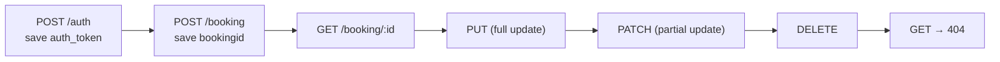

# Restful Booker — REST API Test Automation Suite

[](https://github.com/VusalQarayev/restful-booker-api-automation/actions/workflows/api-tests.yml)


An automated, CI-ready test suite for the public [Restful Booker](https://restful-booker.herokuapp.com) booking API, built with **Postman**, **JavaScript (Chai & Ajv)**, **Newman CLI**, and **GitHub Actions**.

It demonstrates stateful end-to-end request chaining, self-contained test data, JSON Schema contract validation, defensive script design, negative and boundary testing, and automated HTML reporting. Because the target API is intentionally quirky, the suite also doubles as a documented record of its non-standard behaviors (see [Observed API Behaviors](#observed-api-behaviors-and-documented-defects)).

**At a glance:** 14 requests · 70 assertions · 4 folders · runs in roughly 4 seconds in CI

## Table of Contents

- [Quick Start](#quick-start)
- [Key Features](#key-features)
- [Tech Stack](#tech-stack)
- [Repository Structure](#repository-structure)
- [How the Suite Works](#how-the-suite-works)
- [Test Coverage](#test-coverage)
- [Observed API Behaviors and Documented Defects](#observed-api-behaviors-and-documented-defects)
- [Running the Tests](#running-the-tests)
- [CI/CD Pipeline](#cicd-pipeline)
- [Troubleshooting](#troubleshooting)
- [Notes and Limitations](#notes-and-limitations)
- [License](#license)

---

## Quick Start

Requires [Node.js](https://nodejs.org/) 18 or later.

```bash
git clone https://github.com/VusalQarayev/restful-booker-api-automation.git
cd restful-booker-api-automation
npm install
npm test
```

When the run finishes, open **`reports/newman-report.html`** in a browser for the interactive report (request/response payloads, timings, and assertion results).

Prefer a GUI? Jump to [Run in Postman](#option-2-run-in-postman-desktop-or-web).

---

## Key Features

- **Stateful end-to-end chaining.** Authenticates (`POST /auth`), creates a booking with Faker-generated guest data (`POST /booking`), then chains `auth_token` and `bookingid` through `GET`, `PUT`, `PATCH`, `DELETE`, and a post-deletion `404` check.
- **Self-contained search tests.** A `pm.sendRequest` pre-request hook seeds a fresh booking for the search folder, so those tests pass independently even after the CRUD flow deletes its own booking.
- **Strict contract validation.** Ajv JSON Schemas (`pm.response.to.have.jsonSchema()`) enforce required fields, primitive types, nested structure, and `YYYY-MM-DD` date formats.
- **Collection-level quality gates (DRY).** Response-time SLA (`< 3000ms`), gateway-error checks (`502` / `503` / `504`), and fail-fast environment guardrails live at the collection root, so every request inherits them without duplicated code.
- **Defensive script execution.** `pm.response.json()` is only called after HTTP status and `Content-Type` checks. Plain-text errors (`403`, `404`, `405`, `500`) fail with a clear diagnostic message instead of crashing the runner with an uncaught `JSONError`.
- **`PATCH` regression protection.** Verifies the mutated fields (`totalprice`, `additionalneeds`) *and* that omitted fields (`firstname`, `lastname`, `depositpaid`, `bookingdates`) remain unchanged.
- **Negative and boundary coverage.** Invalid credentials, missing authentication, unknown IDs, unsupported `Accept` headers, and incomplete payloads.
- **Credential hygiene.** The committed environment export keeps `password` blank; the value is injected at runtime through the npm script, CLI flags, or GitHub Actions Secrets.
- **CI and reporting.** Runs on every push, pull request, manual trigger, and a daily schedule, and publishes a dark-themed `newman-reporter-htmlextra` report as a downloadable artifact.

---

## Tech Stack

| Technology | Purpose |
| :--- | :--- |
| Postman Collection v2.1 | Requests, pre-request scripts, and test assertions |
| JavaScript / Chai | Test logic and assertions |
| JSON Schema / Ajv | Response contract validation |
| Newman | Command-line collection runner |
| newman-reporter-htmlextra | HTML test reporting |
| GitHub Actions | Continuous integration |
| Node.js & npm | Dependency management and test execution |

---

## Repository Structure

```text
restful-booker-api-automation/
├── .github/
│   └── workflows/
│       └── api-tests.yml                              # CI pipeline and report artifact publisher
├── collections/
│   └── restful-booker.postman_collection.json         # Requests, scripts, schemas, and docs
├── environments/
│   └── restful-booker-qa.postman_environment.json     # Sanitized QA environment (no secrets)
├── .gitignore                                         # Excludes node_modules/, reports/, local logs
├── package.json                                       # Newman dependencies and `npm test` script
├── package-lock.json                                  # Locked dependency tree for reproducible CI installs
└── README.md
```

The `reports/` directory is generated at runtime and is intentionally excluded from Git.

---

## How the Suite Works

### Request flow



The search folder (`03_Search_and_Filtering`) and negative folder (`04_Negative_and_Edge_Cases`) are independent of this chain: search seeds its own booking, and the negative tests use fixed or invalid inputs.

### Runtime variables

| Variable | Set by | Used by |
| :--- | :--- | :--- |
| `auth_token` | `POST /auth` (valid credentials) | `PUT`, `PATCH`, `DELETE` via `Cookie: token={{auth_token}}` |
| `bookingid` | `POST /booking` | `GET`, `PUT`, `PATCH`, `DELETE`, and the 404 verification (cleared afterwards) |
| `password` | Supplied at runtime (never committed) | `POST /auth` |

> **Execution order matters.** The CRUD flow depends on variables created by earlier requests. Always run the collection sequentially (Newman and the Postman Collection Runner both do this by default).

### Test data isolation

The public sandbox periodically wipes its database and invalidates session tokens (documented as roughly every 10 minutes). The suite therefore never depends on persistent data. It creates its own token and bookings at runtime, which lets the whole suite run end to end without state drift.

---

## Test Coverage

The collection contains **14 requests** (15 HTTP calls, counting the search pre-request seeding) and **70 assertions** across four folders.

### 01_Health_and_Auth

| Request | Endpoint | Key checks |
| :--- | :--- | :--- |
| Health Check - Ping | `GET /ping` | Service is available; asserts the observed `201 Created` and plain-text `"Created"` body |
| Create Auth Token - Valid Credentials | `POST /auth` | `200 OK`, JSON header, alphanumeric token format; saves `auth_token` |

### 02_Booking_E2E_CRUD_Flow

| Request | Endpoint | Key checks |
| :--- | :--- | :--- |
| Create Booking - Valid Payload | `POST /booking` | Faker-generated guest data, nested Ajv schema, echoed values; saves `bookingid` |
| Get Booking by ID | `GET /booking/{{bookingid}}` | Read-after-write persistence, flat Ajv schema, business rule `checkout > checkin` |
| Update Booking - Full | `PUT /booking/{{bookingid}}` | Cookie authentication, full replacement, flat Ajv schema |
| Partial Update Booking | `PATCH /booking/{{bookingid}}` | Mutated fields changed *and* untouched fields preserved |
| Delete Booking by ID | `DELETE /booking/{{bookingid}}` | Cookie authentication; asserts the observed `201 Created` deletion response |
| Verify Booking Deleted (404) | `GET /booking/{{bookingid}}` | `404 Not Found` confirms permanent deletion; clears the runtime `bookingid` |

### 03_Search_and_Filtering

| Request | Endpoint | Key checks |
| :--- | :--- | :--- |
| Filter Bookings by Guest Name | `GET /booking?firstname=...&lastname=...` | Seeds a fresh booking via `pm.sendRequest`; validates URL-encoded query filtering, array structure, and `bookingid` match |

### 04_Negative_and_Edge_Cases

| Request | Endpoint | Key checks |
| :--- | :--- | :--- |
| Create Auth Token - Invalid Credentials | `POST /auth` | `"Bad credentials"` payload and no token leaked |
| Update Booking - Unauthorized (Missing Token) | `PUT /booking/1` | `403 Forbidden` when the session cookie is omitted |
| Get Booking - Non-Existent ID (404) | `GET /booking/99999999` | `404 Not Found` for an unknown record |
| Get Booking - Unsupported Accept Header (418) | `GET /booking/1` with `Accept: text/xml` | `418 I'm a teapot` on an unsupported media type |
| Create Booking - Missing Required Fields | `POST /booking` | Documents the unhandled `500 Internal Server Error` for an incomplete payload |

---

## Observed API Behaviors and Documented Defects

Restful Booker is intentionally built with realistic legacy quirks. Rather than ignoring them, this suite asserts and documents each one. These are regression checks on **observed** behavior, not recommendations for REST API design.

| # | Endpoint / scenario | Observed behavior | Common REST expectation | How the suite handles it |
| :--- | :--- | :--- | :--- | :--- |
| 1 | `GET /ping`, `DELETE /booking/:id` | `201 Created` with plain-text body `"Created"` | `200 OK` (ping); `200 OK` or `204 No Content` (delete) | Asserts `201` and the text body, with no JSON header checks |
| 2 | `POST /auth` with invalid credentials | `200 OK` with `{"reason": "Bad credentials"}` | `401 Unauthorized` | Asserts `200` plus the error message, and verifies no `token` key is exposed |
| 3 | `POST /booking` with missing required fields | `500 Internal Server Error` | `400 Bad Request` with validation details | Dedicated negative test captures the unhandled server error |
| 4 | `GET /booking?checkin=...&checkout=...` | Strict greater-than date comparison returns `[]` for an exact check-in date | Inclusive (`>=`) range filtering | Search tests filter by `firstname` and `lastname` for reliable lookup; the date bug is documented in the request docs |
| 5 | `PUT`, `PATCH`, `DELETE /booking/:id` | `Authorization: Bearer <token>` is rejected with `403`; requires `Cookie: token=<token>` | `Authorization: Bearer` header | Uses the cookie header and includes a negative test for the missing-cookie `403` |
| 6 | `PUT`, `PATCH /booking/:id` for a missing or reset ID | `405 Method Not Allowed` | `404 Not Found` | Defensive status and content-type guards produce clear diagnostics |
| 7 | `GET /booking/:id` with `Accept: text/xml` | `418 I'm a teapot` | `406 Not Acceptable` | Positive requests send `Accept: application/json`; a negative test verifies `418` |
| 8 | All stateful endpoints | Sandbox resets data and tokens periodically (about every 10 minutes) | Persistent test environment | Runtime token and booking creation; the suite is self-contained |

---

## Running the Tests

### Option 1: Newman CLI

```bash
npm install   # installs Newman and newman-reporter-htmlextra
npm test      # runs the full suite and writes reports/newman-report.html
```

The npm script supplies the public sandbox password at runtime, so nothing sensitive is stored in the repository.

### Option 2: Run in Postman (Desktop or Web)

1. Open Postman and click **Import**.
2. Import both files:
   - `collections/restful-booker.postman_collection.json`
   - `environments/restful-booker-qa.postman_environment.json`
3. Select **`Restful-Booker-QA`** from the environment dropdown.
4. Open the environment and set the **`password`** value to `password123` (the public sandbox password). It is blank in Git on purpose; don't commit populated credentials.
5. Click **`...`** next to **`Restful-Booker-API-Automation`** → **Run**, and run all folders sequentially in the Collection Runner.

---

## CI/CD Pipeline

The workflow at **`.github/workflows/api-tests.yml`** runs the Newman suite on:

- Every **push** or **pull request** targeting `main`
- A **daily schedule** (`08:00 UTC`) to monitor the external API's availability
- **Manual runs** via **Actions → Restful Booker API Automation CI → Run workflow**

### Viewing the HTML report

After any run completes (pass or fail), open the run summary in the **Actions** tab and download **`newman-html-report-<run_number>`** from the **Artifacts** section.

### Optional: override the password with a secret

The workflow defaults to the public sandbox password so forks run out of the box. To override it securely in your own repository:

1. Go to **Settings → Secrets and variables → Actions**.
2. Click **New repository secret**.
3. Name it `API_PASSWORD` and save your value.

Never place real credentials in the collection, environment export, README, or workflow file.

---

## Troubleshooting

| Symptom | Likely cause | Fix |
| :--- | :--- | :--- |
| `403`, `405`, or `404` failures midway through the CRUD flow | The sandbox reset its data or tokens during the run | Re-run the suite; each run creates fresh data |
| Auth step fails or `auth_token` is empty | `password` is blank in the environment | Set `password` in Postman, or run `npm test` |
| Later requests fail with unresolved `{{bookingid}}` or `{{auth_token}}` | Requests were run individually or out of order | Run the whole collection sequentially |
| Intermittent failures at certain times of day | The public Heroku sandbox may be slow or temporarily unavailable | Check the API status and retry; the SLA check fails above 3000ms |

---

## Notes and Limitations

- This project targets a **public demo API**, not a production service. Its data and behavior may change without notice.
- The deviations listed above are observations from the test environment and may change over time.
- A test that asserts an observed defect **documents current behavior**; it does not mean that behavior is correct.
- Requests share runtime variables, so the suite depends on **sequential execution**.
- The HTML report is generated locally or in CI and should not be committed.

---

By Vusal Qarayev